# **Lab 00 - Setting up the lab environment**

In this lab, you will set up a complete trial environment required for working with Microsoft Power Platform and Dynamics 365 applications. You will sign up for trial licenses, configure environments, enable Copilot capabilities across services, and install required add-ins to support learning activities throughout the course.

## **Exercise 1: Assign a Power Apps trial license**

1.  Open a web browser on your VM and go to +++https://powerapps.microsoft.com/en-us/free/+++

    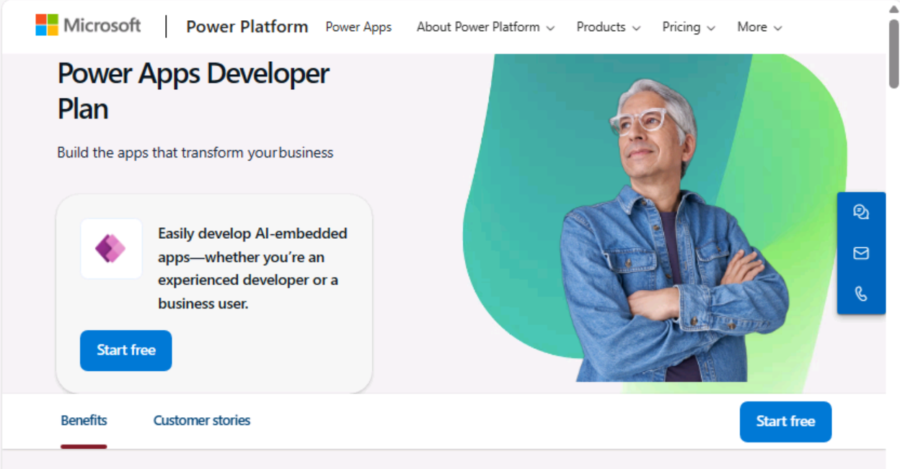

2.  Select **Start free**.

    

3.  Enter your **Office 365 admin credentials**, check the checkbox to **accept the agreement** and click on **Start free**.

    

4.  Enter your **Microsoft 365** tenant admin password, and then select **Sign in**.

    

5.  Select **Yes** on **Stay signed in** pop-up window.

    

6.  Keep the **United States** as your **country/region** and then click on the **Get started** button.

    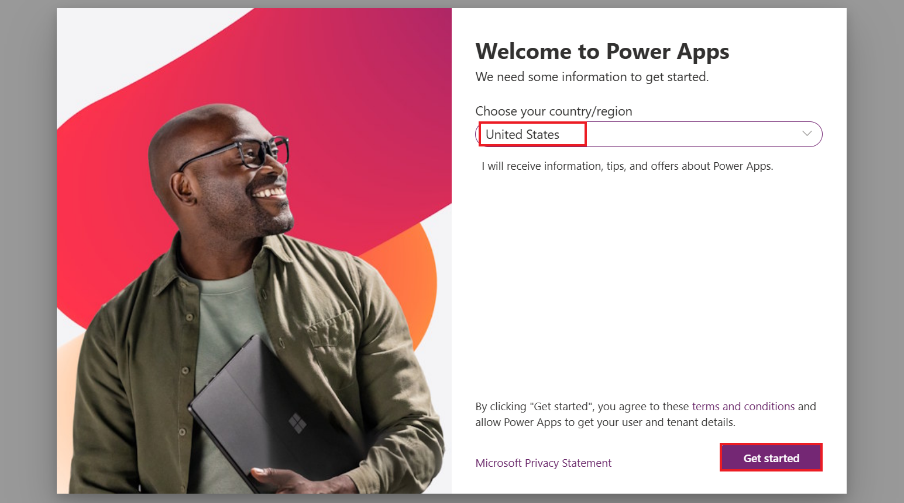

7.  You can now see the **Power Apps** home page with the **Dev One** environment, which is the developer environment created for you.

    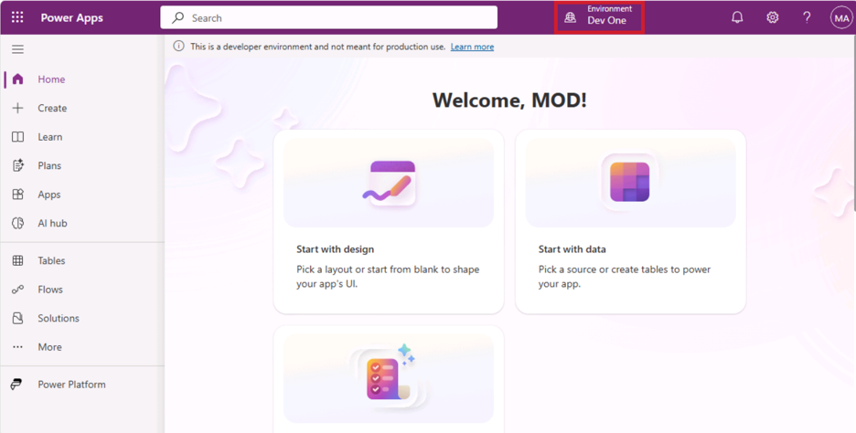

8.  If you are directed to the default **Contoso (default)** environment, select the required **Dev One** environment for the lab from the drop-down list..

    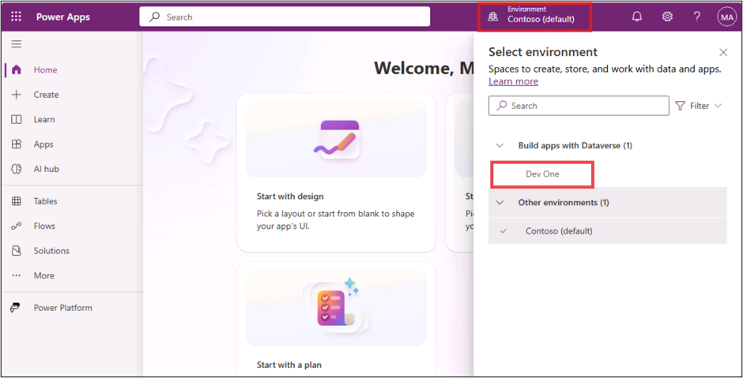

9.  Open the new tab and go to the **Power Platform admin center** by navigating to +++https://admin.powerplatform.microsoft.com+++ and if required, **sign in** using your given Office 365 admin tenant credentials.

    

10. From the left navigation pane, select **Manage** > **Environments**, and then you can see that **Dev One** is your Dataverse environment.

    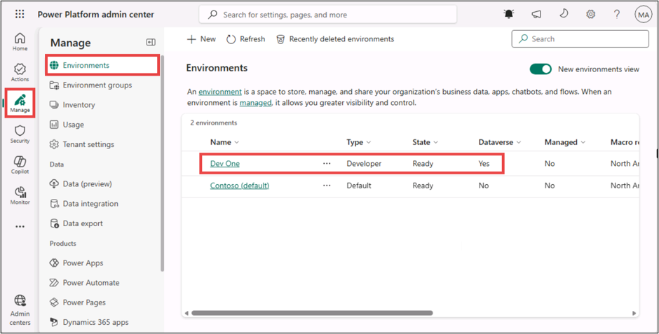

## **Exercise 2: Assign a Customer Service trial license and enable Copilot**

### **Task 1: Assign Customer Service trial license**

In this task, you will start a **Dynamics 365 Customer Service trial**, provide the required contact information, and confirm that a **Customer Service Trial environment** has been provisioned in the Power Platform admin center.

1.  Open your browser and browse to **+++https://dynamics.microsoft.com/en-in/customer-service/overview/+++** and select **Try for free**.

    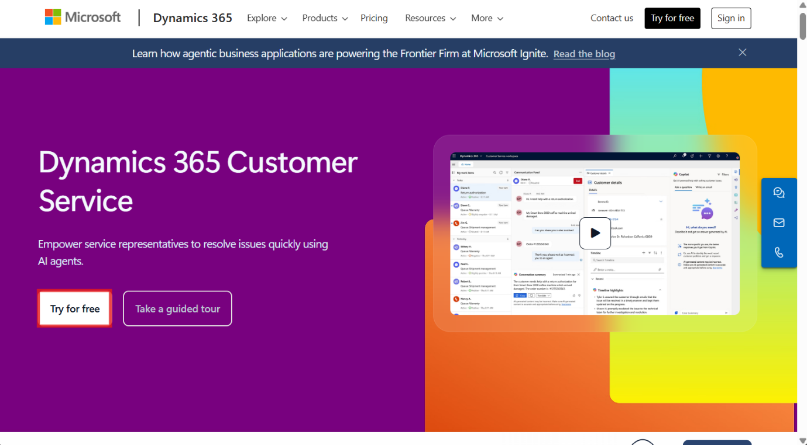

2.  Enter your Office 365 admin **tenant credentials**, select the checkbox to accept the agreement and click on **Start your free trial**.

    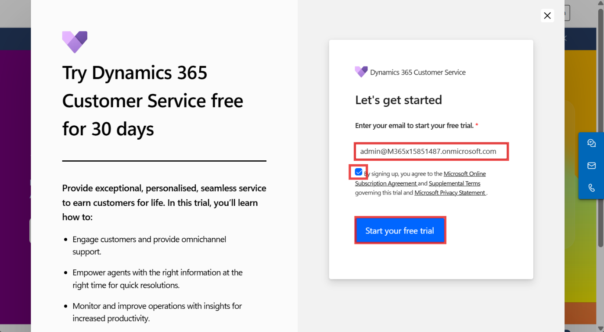

3.  Provide Contact Information as below and then select **Submit**.

    - **Job Title**: Your job title

    - **Country/region**: United States

    - **Phone number**: Your phone number

    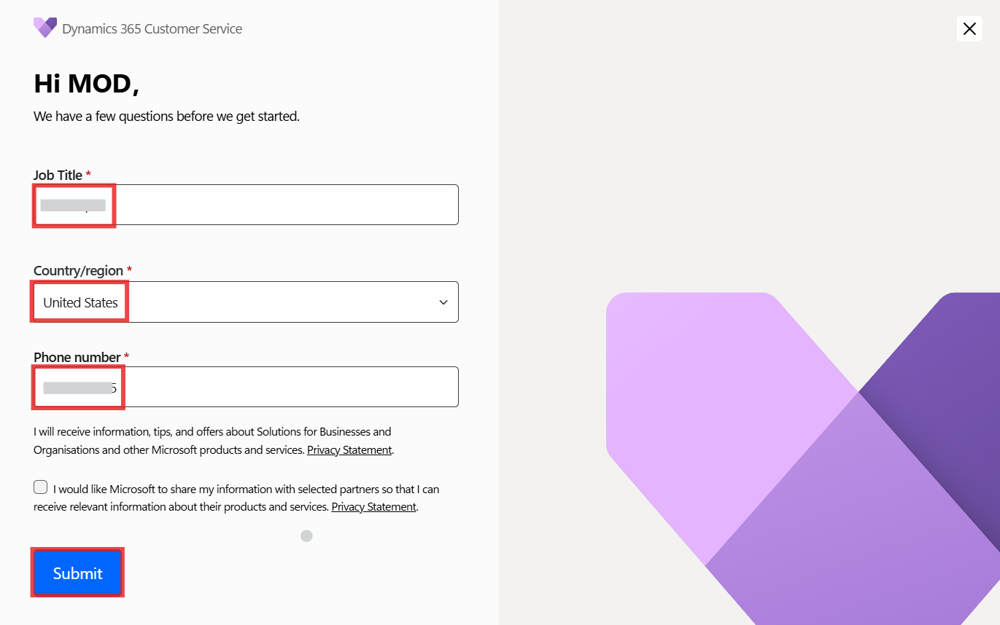

4.  If requested, enter your Office 365 admin tenant password.

    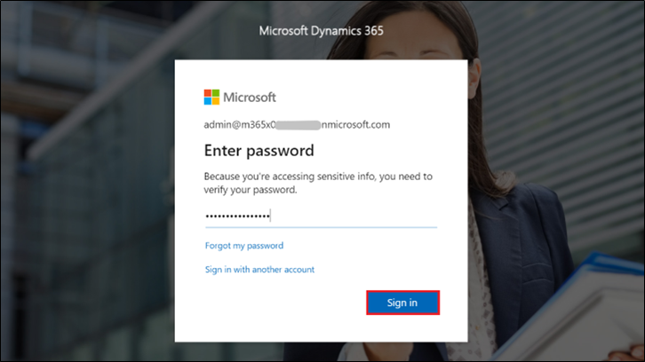

5.  You will land on the **Copilot Service Workspace** portal.

    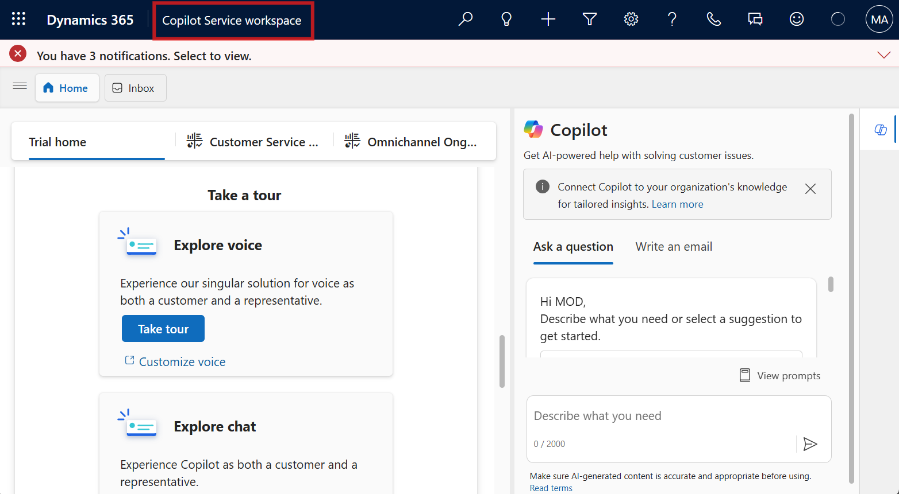

## Exercise 3: Activate Dynamics 365 Contact Center Trial

In this exercise, you activate the Dynamics 365 Contact Center trial to access the Copilot Service workspace and required administration tools.

1.  Open a **Microsoft Edge** in private window and navigate to the **+++https://www.microsoft.com/en-us/dynamics-365/products/contact-center+++** page.

2.  On the **Contact Center** page, select **Try for free**.

    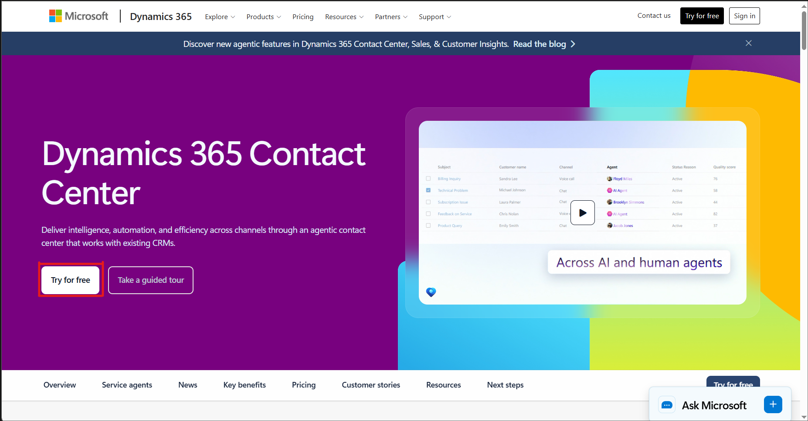

3.  On the **Let's get started** page, enter the administrator tenant ID.

4.  Select the **agreement** check box and select **Start your free trial**.

    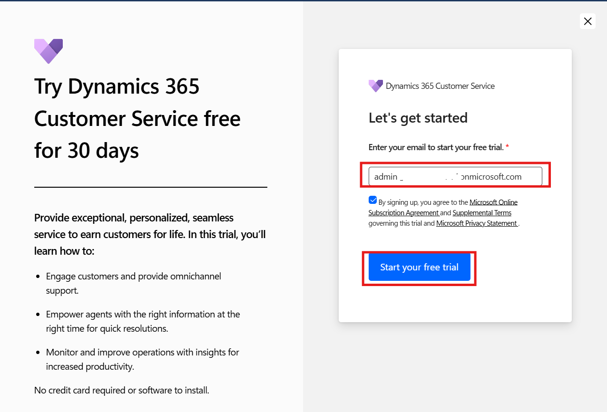

5.  If prompted, enter the password and select **Sign in**.

     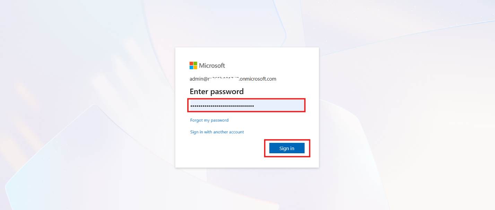

6.  Enter the required details, such as **Job title**, **Country/Region** and **Phone number**.

7.  Select the **agreement** check box and select **Get started**.

    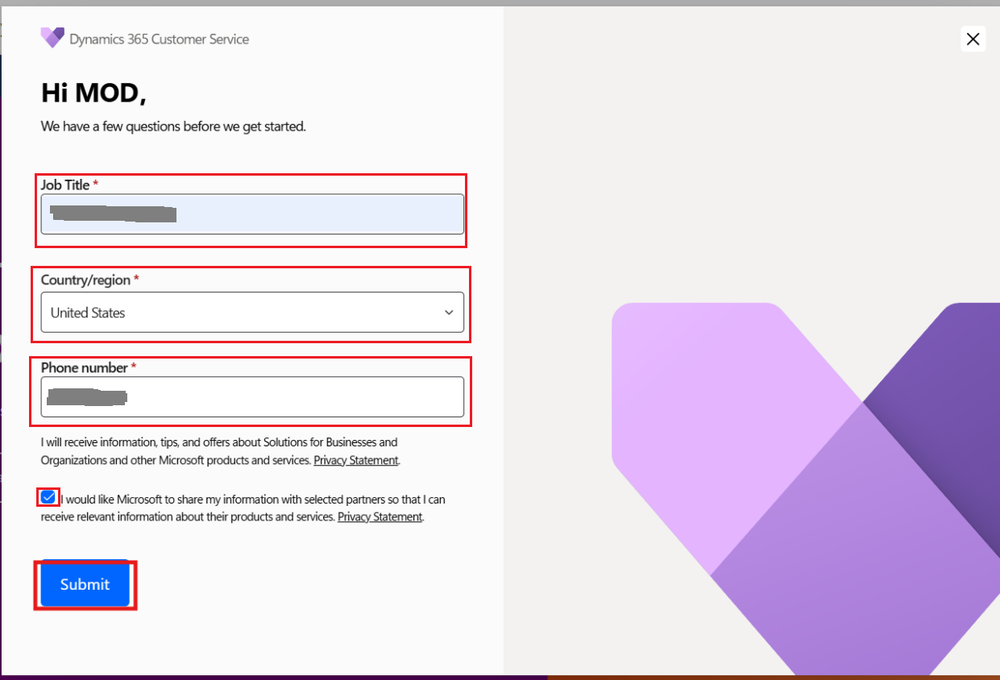

8.  After the trial is activated, confirm that you are redirected to the **Copilot Service Workspace**.

9.  From the top app launcher, select **Copilot Service Admin Center**, if the pop-up appears, select **Skip & go to home page**.

    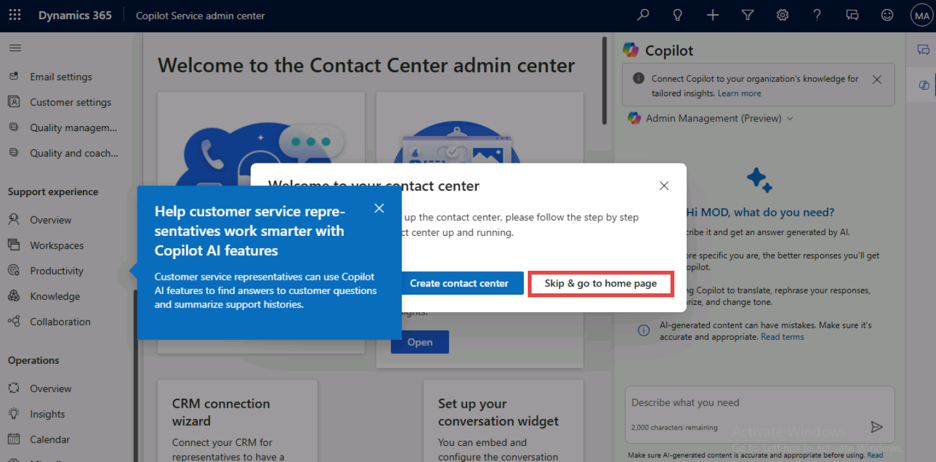

10. Select **Create** on the **Create your contact center** tile.

    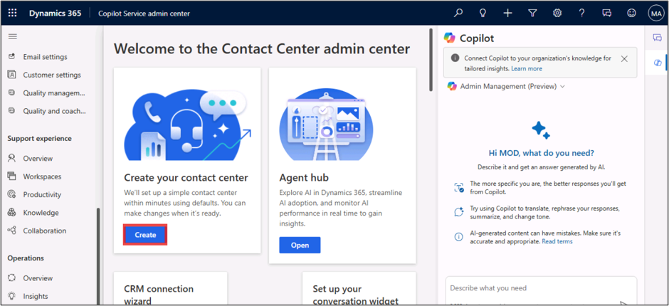

11. Wait till the setup is complete. Verify that the Your contact center is ready! message appears and confirms that the Chat setup, Voice setup, and AI experiences are configured.

    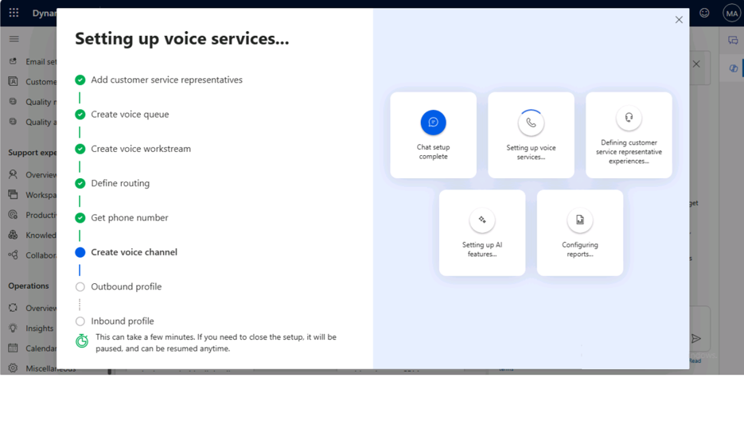

  
    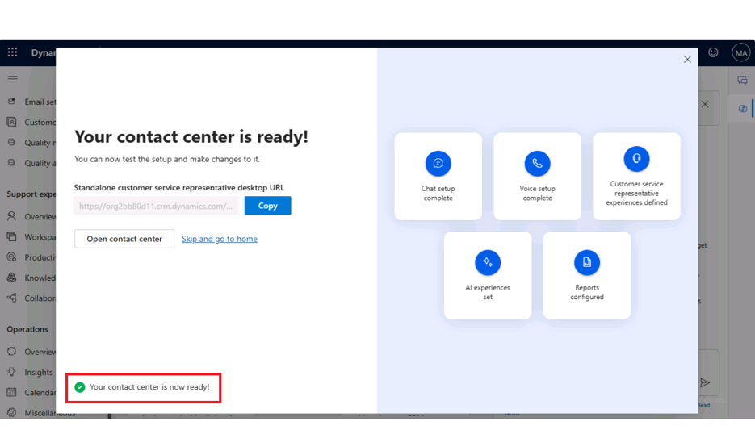

13. Verify that the **Your contact center is ready!** message appears and confirms that the **Chat setup**, **Voice setup**, and **AI experiences** are configured.

14. Select **Open contact center** to open the **Copilot Service Admin Center** and **manage** the contact center settings.

    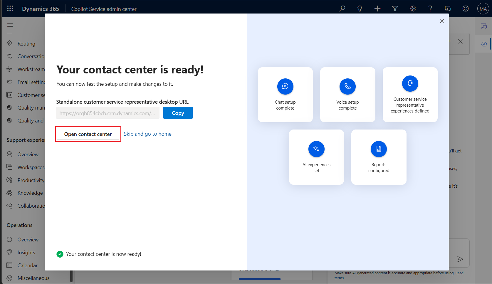

**Summary** 
You have successfully activated the **Power Apps**, **Customer Service** and **Contact Center** trial license and verified that the required **Dataverse-enabled environment** is available in the **Power Platform admin center**, providing the environment required for the lab activities.
