# **Lab 05 - Setting up the lab environment**

## **Objective**
In this lab, you will set up a complete trial environment required for working with Dynamics 365 applications. You will sign up for trial licenses, configure environments, create a team in Microsoft Teams, enable Copilot capabilities across services and install required add-ins to support learning activities throughout the course.

## **Exercise 1: Assign a Sales trial license**

### **Task 1: Assign Sales license**

In this task, you will start a Dynamics 365 Sales trial, provide the required contact information, and confirm that a Sales Trial environment has been provisioned in the Power Platform admin center.

1. Open your browser and browse to +++https://www.microsoft.com/en-us/dynamics-365/products/sales+++ and select **Try for free**.

    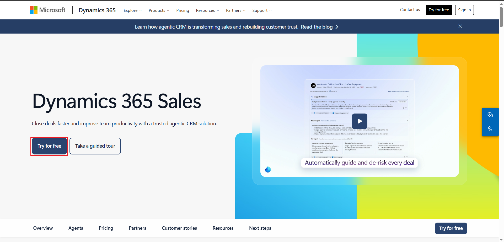

2. If requested, enter your Office 365 admin tenant credentials. Select the checkbox to accept the agreement and click on **Start your free trial**

    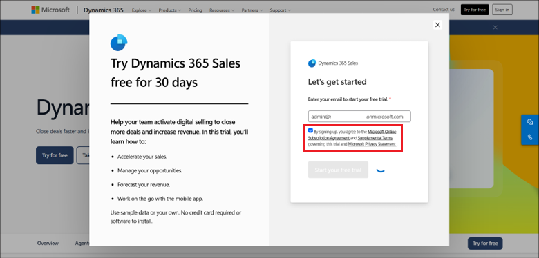
3. If requested, enter your Office 365 admin tenant password.
   
4. If requested, provide Contact Information as below and then select Submit.

    - Job Title: Your job title

    - Country/region: United States

    - Phone number: Your phone number
  
7. Go to **Power Platform admin center** by navigating to **+++https://admin.powerplatform.microsoft.com+++**.

   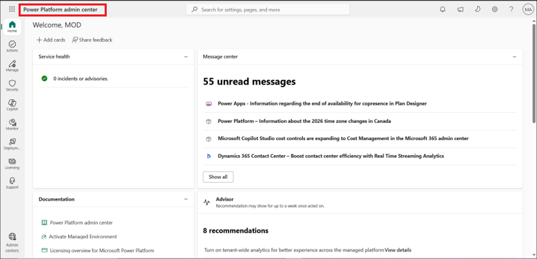

9. From the left navigation pane, select **Manage** > **Environments**, and then verify that the **Sales Trial** environment was created successfully.

   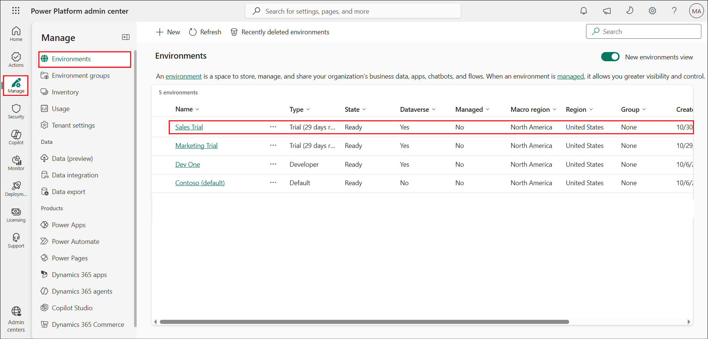

   
## **Exercise 2: Assign a Customer Insight trial license**

### **Task 1: Assign Customer Insight trial license**

In this task, you will start a Dynamics 365 Customer Insight trial, provide the required contact information, and confirm that a Customer Insight Trial environment has been provisioned in the Power Platform admin center.

1. Open your browser and browse to +++https://www.microsoft.com/en-us/dynamics-365/products/customer-insights+++ and select **Try for free**.

    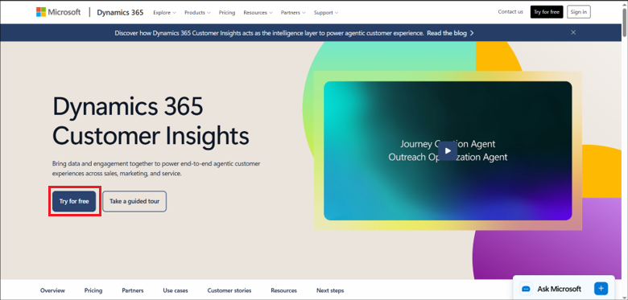

2. Enter your Office 365 admin tenant credentials.

    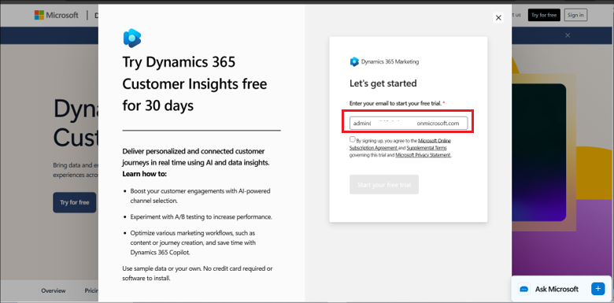

3. Select the checkbox to accept the agreement and click on **Start your free trial**.

    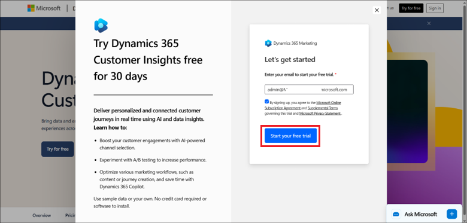

4. Enter your Office 365 admin tenant password.

   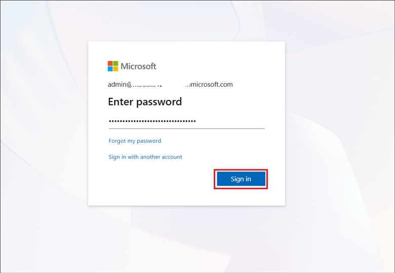

5. Select **Yes** to Stay Signed in?

    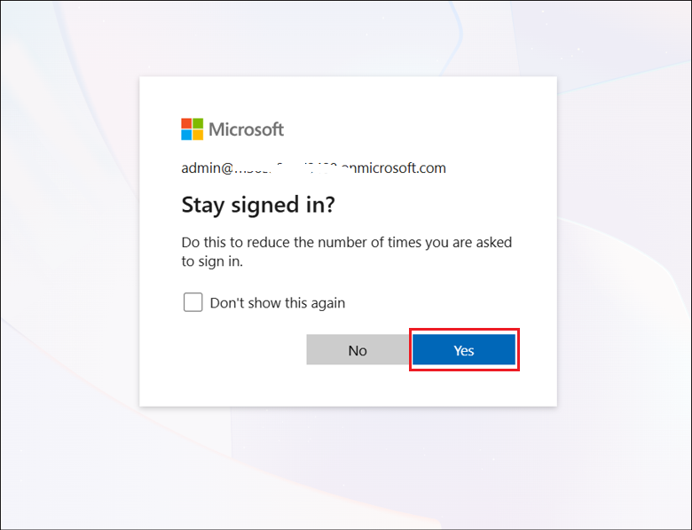

6. Provide Contact Information as below and then select Submit.

    - Job Title: Your job title

    - Country/region: United States

    - Phone number: Your phone number

    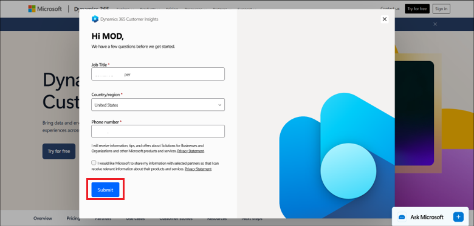

7. Go to **Power Platform admin center** by navigating to **+++https://admin.powerplatform.microsoft.com+++**.

   

9. From the left navigation pane, select **Manage** > **Environments**, and then verify that the **Marketing Trial** environment was created successfully.

   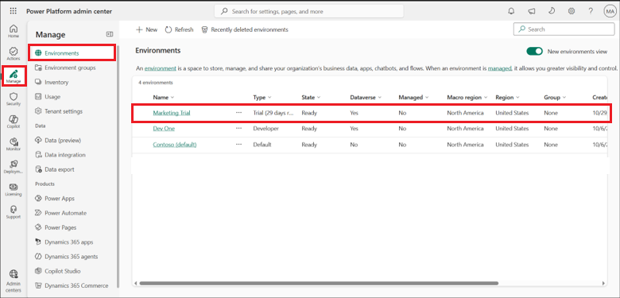

<!-- ## **Exercise 1: Assign a Power Apps trial license**

1.  Open a web browser on your VM and go to **+++https://powerapps.microsoft.com/en-us/free/+++**

   

2.  Select **Start free**.

   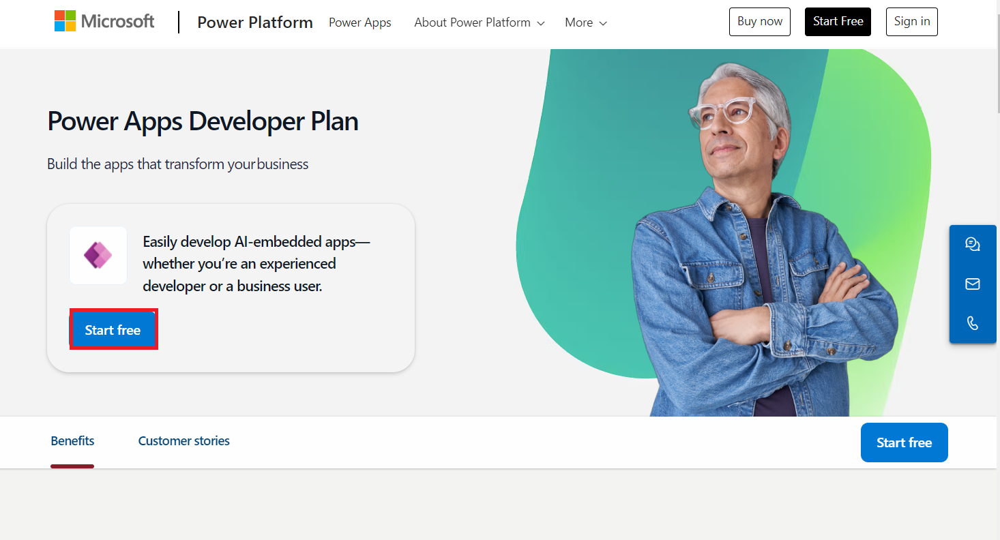

3.  Enter your **Office 365 admin credentials**, check the checkbox to **accept the agreement** and click on **Start free**.

   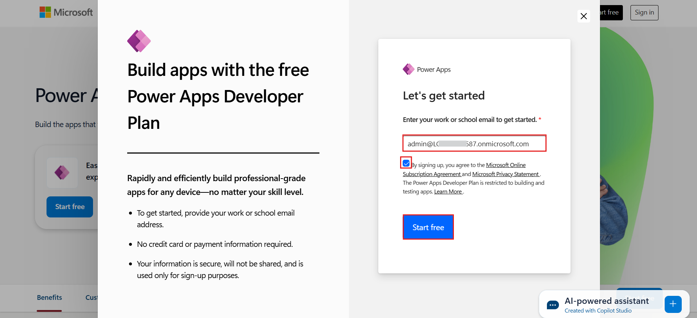

4.  Enter the **password of your Office 365 tenant id** and then select **Sign in**.

   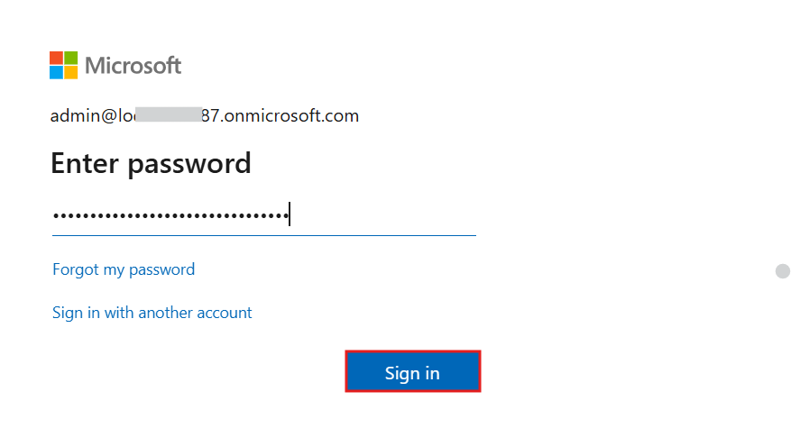

5.  Select **Yes** on **Stay signed in** pop-up window.

   

6.  Keep the **United States** as your **country/region** and then click on the **Get started** button.

   

7.  You can now see the **Home page of Power Apps** and the default environment **Contoso (default)** – which has been created for you.

   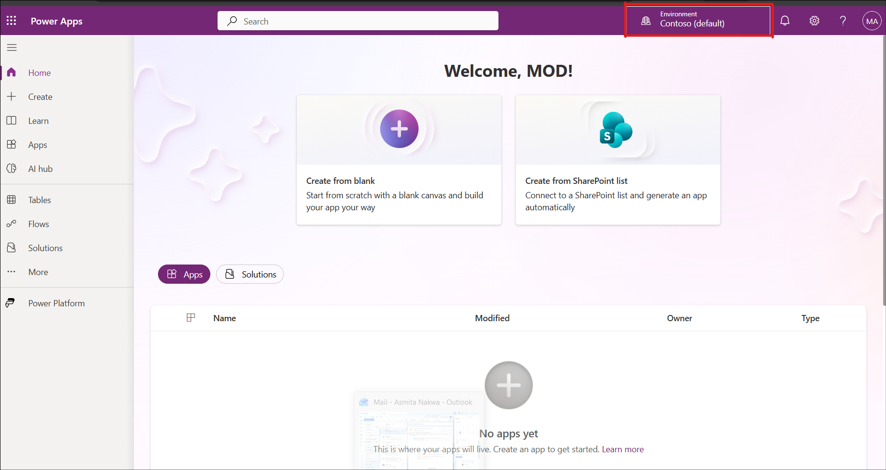

8.  Select from the drop down your required environment.

   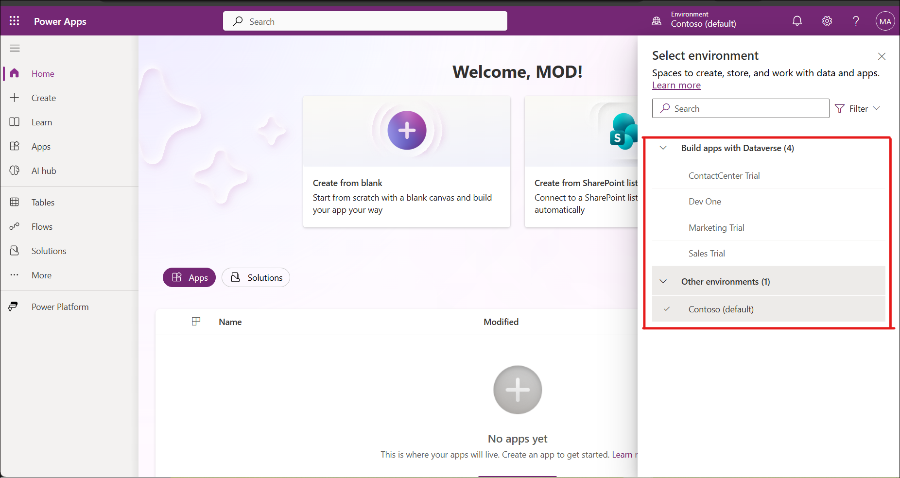

9.  Open the new tab and go to the **Power Platform admin center** by navigating to **+++https://admin.powerplatform.microsoft.com+++** and if required, sign in using your given Office 365 admin tenant credentials.

   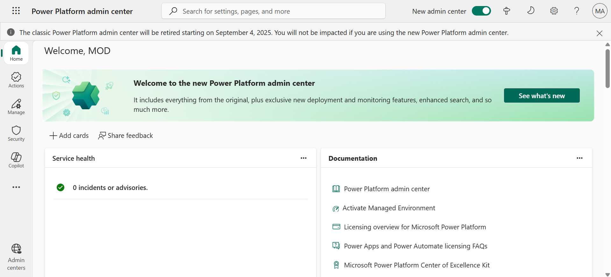

10. From the left navigation pane, select **Manage > Environments**. From the list of environments, select the **Dataverse environment** required for the lab.

   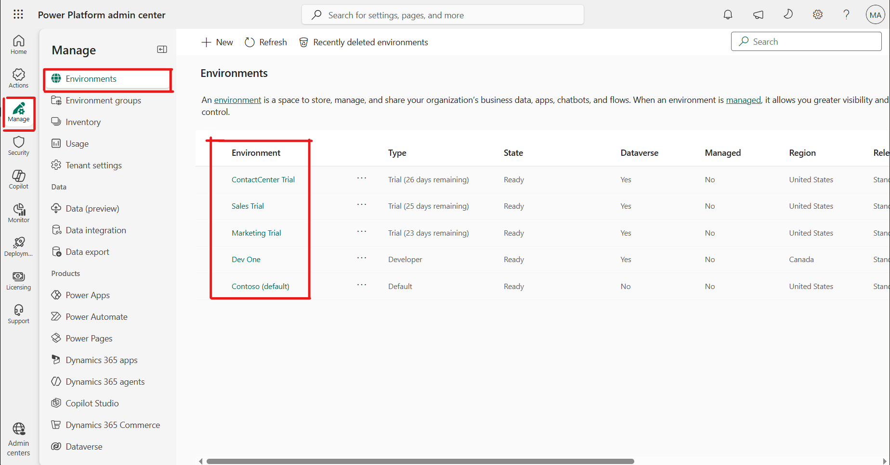
-->
